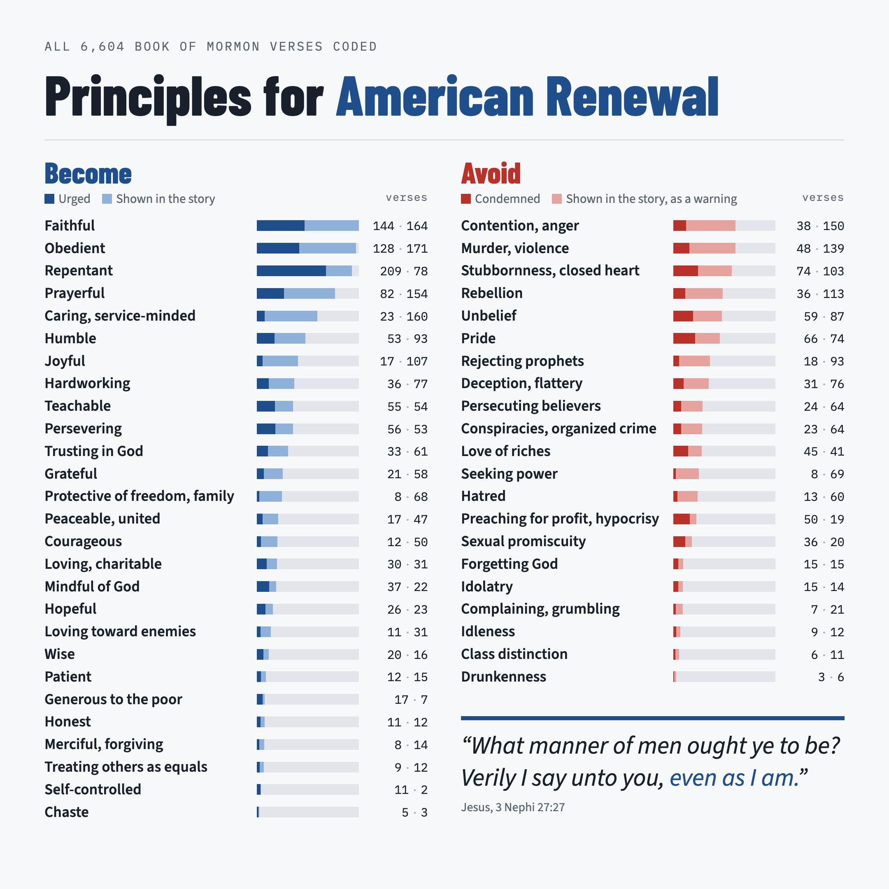

I've enjoyed and been inspired this year commemorating America's 250th year as an independent nation. I had the chance to visit Philadelphia and take in some of the places where the founding documents were debated and written. I've also been reading *1776* by David McCullough and started listening to Walter Isaacson's biography of Benjamin Franklin.

Ben Franklin was one of my dad's biggest heroes. I grew up learning about Franklin's system of trying to achieve moral perfection that my dad was so impressed by. In Philadelphia I visited the Benjamin Franklin Museum and learned much more about his life and accomplishments, and have only recently come to appreciate why my dad was so inspired by his life.

I also recently watched the movie *Young Washington*, which led me to research more about Washington in his 20s. I was amazed to learn for the first time of his apparently miraculous survival in an early battle, after which, in a letter to his brother, he wrote: "By the all-powerful dispensations of Providence, I have been protected beyond all human probability and expectation; for I had four bullets through my coat, and two horses shot under me, yet escaped unhurt, altho' death was levelling my companions on every side."

America's founding is full of apparently miraculous events.

I also recently finished reading the Book of Mormon again, which is a misunderstood and underappreciated masterpiece of American origin. The Book of Mormon is one of the most impactful books ever to originate from America, with 200 million copies printed in over 100 languages. Yet most people still know very little of what it says or completely misunderstand it. It's an ambitious read of over 500 pages of challenging prose, so it's understandable why. Some say it is a work of fiction; others claim a divine origin. In a sense, its origin has little bearing on its deserved status as a masterpiece of American literature. Indeed, even fiction is often praised for the profound truths it can convey. Yet the divine origin story is compelling, with a richly documented history, most notably by Richard Bushman in his recent book *Joseph Smith's Gold Plates*.

More importantly, the final pages of the book itself contain a method by which the reader is invited to learn its truth. The book argues that "whatsoever thing is good is just and true." It invites the reader to reflect on the narrative history and principles composing its 500+ pages and ask God "if these things are not true." I was always puzzled by the negation in the phrase "not true." I had a new insight finishing the book again this time, though. I realized that this phrasing suggests that, if the book has been read with a believing heart and an open mind, one is likely to find it is almost obviously true. And so the question to ask is not, "Is this true?" But rather, "This actually seems true, so much so that I think I'm going to actually try to live these principles, unless you tell me this is not true... is this not true?" The answer becomes nearly self-evident, as the illustration below shows. It summarizes what the Book of Mormon asks of the reader.

{fig-alt="Chart of the traits the Book of Mormon asks readers to become and to avoid, with verse counts from all 6,604 verses"}

Bringing this back to America 250: the Book of Mormon has a special American origin, and I believe it contains the principles we all need to strive for in order to achieve American renewal in our country's next 250 years.

Reader beware: if you read the Book of Mormon with a believing heart and an open mind, it will probably cause you to change a few things in your life. I know it has for me.
